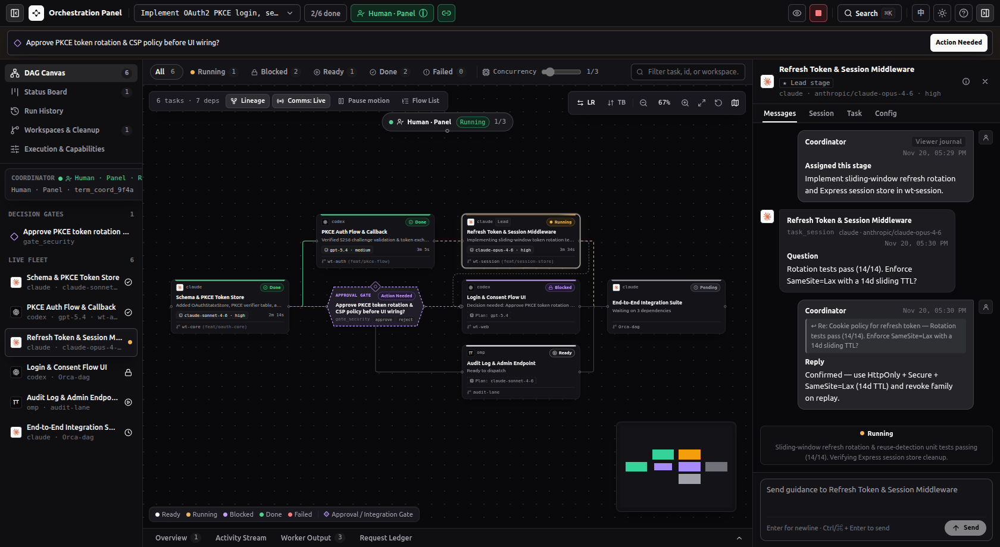

# Orca DAG — skill + viewer

English | [简体中文](README_zh.md)

> Forked from [ZinkLu/Orca-Orchestration](https://github.com/ZinkLu/Orca-Orchestration), extended and published independently as [`orca-orchestration-launcher`](https://www.npmjs.com/package/orca-orchestration-launcher).

`orca-dag` splits agent-based planning from execution and visualization:

1. **Skill** (`skill/SKILL.md`): Your agent writes a PRD, technical design, and Orca task DAG, using the runtime-matched orchestration guide. Planning stays in your agent; the viewer embeds no Agent SDK.
2. **Viewer** (`server/` + `web/`): Inspect the live DAG, choose per-node launch settings, and let the built-in coordinator dispatch ready tasks along dependency edges.



## Prerequisites

CLI examples use `orca` inside managed Orca terminals; on Linux outside them, use `orca-ide`, not the GNOME screen reader at `/usr/bin/orca`. Explicit overrides and development builds follow the [startup resolution rules](docs/tutorials/viewer-operations.md#startup-parameters).

- **Orca version:** ≥ **1.4.160** for viewing, ≥ **1.4.205** for executing (`result.runtime.appVersion` in `orca status --json`). Older runtimes (<1.4.160) are unsupported; 1.4.160–1.4.204 runs in view-only mode.
- **Orca state:** Orca must be running (`orca status --json` reports `"ready"`; run `orca open` if not).
- **Experimental features:** Orchestration experimental feature must be enabled (**Settings → Experimental**).
- **Managed workspace:** Project must be an Orca-managed worktree (`orca repo add <path>` or `orca worktree ...`).
- **Agents:** Selected worker agents must be installed and configured in Orca, and able to execute tools and report `worker_done` autonomously.
- **Presets:** `claude`, `codex`, `opencode`, `omp`, and `antigravity`, within their [version and placement limits](docs/reference/compatibility.md). The other five unverified agent IDs remain unavailable, even with custom commands enabled.
- **Runtime:** **Node.js ≥ 20** for npm, or a standalone binary; both need the resolved Orca CLI on PATH.

## Installation

Start from the **root of an Orca-managed project** in an ordinary shell. Inside an Orca terminal, use the [clean-environment startup recipe](docs/tutorials/viewer-operations.md#startup-parameters) to avoid inherited terminal-identity conflicts.

```bash
cd ~/any/orca-managed/project
npx orca-orchestration-launcher
```

This installs the `orca-dag` skill for detected coding agents, initializes a managed `.orca-dag/` ignore rule, and serves the viewer at <http://localhost:8787>. Shared-agent and relocated-home rules are covered in [skill installation](docs/tutorials/viewer-operations.md#skill-installation-and-agent-homes). Planning documents and viewer history stay local in `.orca-dag/`.

> **No Node.js?** Download a standalone binary from [GitHub Releases](https://github.com/yyq19990828/Orca-dag/releases). For skill-only use without the viewer: `npx skills add yyq19990828/Orca-dag --skill orca-dag --global`.

## Quick Start

After installation:

1. **Plan in your agent:**
   > Use the orca-dag skill: break "add CSV export to the reports page" into a task DAG.

   The agent writes `.orca-dag/<timestamp>/{PRD.md,TECH_SPEC.md}` and returns the Run ID.
2. **Select and configure:** Pick that Run in the viewer. Choose the default harness, supported per-node overrides, and **Max parallel**.
3. **Run:** Click **"▶ Run with Orca"** and confirm coordinator handoff; it fences the previous coordinator for this Run.
4. **Observe and decide:** Follow Activity, Chat, and worker outcomes. Resolve approval gates; resolve cross-workspace integration gates only after verifying integration.
5. **Revise:** Ask the agent to rebuild task definitions or dependencies in a fresh Run; keep the old Run as history.

## Key Features

- **Live Visual DAG & Sectional Workbench:** Modern sectional workbench with deep navy navigation, crisp 1px borders, real-time status updates (every 2s), switchable task list and lazy-loaded DAG canvas (Dagre layered & force-directed layouts), central detail inspector, and pinned communication dock.
- **Agent controls:** Per-node harness selection, model/effort overrides on supported adapters, and OpenCode Auto / Mini TUI / Full TUI modes.
- **Local & Remote Placement:** 4 local placement modes (current, existing, new-child, new-top-level) and 2 remote placement modes on connected environments.
- **Workspace Lanes:** Serial execution chains across shared isolated worktrees with human-asserted integration gates.
- **Observability & Audit:** Real-time Activity timeline (SSE), stage-scoped Chat, live check receipts, and pre-mutation request audit ledger (`.orca-dag/requests.jsonl`). The stream pauses when hidden and refreshes on return.
- **Operations & Governance:** Scoped worker operations (output, release, retain), on-demand workspace cleanup with safe merged-branch deletion, canonical gate creation for pending tasks, and bounded workspace-scoped Run pagination.
- **Bilingual Interface:** Instant one-click toggle between English and Simplified Chinese (**中 / EN**).

## Important Caveats

- **Task definitions are immutable:** Specs, titles, and dependencies cannot be edited in place; status/results can change. Replan in a fresh Run. Never use `reset --tasks` for this: it wipes all Runs.
- **Unknown ≠ dead:** Unknown or disconnected workers keep their concurrency slots; uncertainty never authorizes automatic retry, cancellation, or replacement.
- **Messaging, coordinator authority, and recovery:** Runtime mailbox and coordinator semantics differ; follow the installed guide. The official public orchestration contract is contract 1 (`orchestration.contract.v1`), runtime protocol is 3, federation lifecycle settlement protocol is 3, and control mail protocol is 2; `[orca-dag:merge-inputs-v3]` is a local viewer contract marker. One-off coordinator mutations refuse implicit takeover (requiring explicit control consent with 409 `coordinator_control_required`). StopReason escalations are events, not replyable question threads. Critical recovery journals (`mailboxChecks`, `guidanceSends`, `operatorMessages`) in `sessions.json` act as recovery authority, not rotating audit logs, and cannot safely be hot-downgraded across unsupported readers. Worker output, release, and retain are strictly scoped to the selected Run. Incomplete remote observations (`partialHostErrors`) are preserved across worker list pages and never clear debt. Worktree cleanup uses the `worktree` parameter, guards active/main workspaces, and safely deletes only merged branches (`preservedBranch`). See [orchestration](docs/tutorials/orchestration.md#worker-and-mailbox-parameters-you-will-see) and [HTTP API](docs/reference/http-api.md#guidance-delivery-recovery-and-follow-up-lifecycle).
- **Local control plane:** The server binds `127.0.0.1`, has no CORS, and requires `X-Orca-Dag-Token` for mutations. Custom commands are opt-in.
- **OMP / Antigravity:** Local Linux Current or exact Existing requires running Orca and resolved CLI ≥ **1.4.245**; new Git worktrees (`new-child`, `new-top-level`) and workspace lanes require both ≥ **1.4.246**. Lanes share workspaces, not agent sessions. Native `worker-start --agent` follows Orca's Chat/Terminal settings; model selectors pass through unchanged, and nonempty effort is rejected. See [placement, output, Stop, and verification boundaries](docs/reference/compatibility.md#path-boundaries-and-historical-findings).
- **Native Chat status limitation:** Working structured workers can appear as `unverifiable / missing_status`, with no provider and unknown activity in Orca fleet. Reproduced with OMP on **1.4.245**; **1.4.246** source/function replay still shows the gap. Upstream [PR #34068](https://github.com/stablyai/orca/pull/34068) remained open on **2026-11-03**. Missing status does not prove launch failure or authorize replacement; see [verified behavior and safe handling](docs/tutorials/viewer-operations.md#known-limitations).

## Documentation

Start with the [documentation index](docs/README.md) ([中文](docs/README_zh.md)).

| Area | Guides |
| --- | --- |
| Tutorials | [Plan a DAG](docs/tutorials/orchestration.md) · [Operate the viewer](docs/tutorials/viewer-operations.md) · [Worktree isolation](docs/tutorials/worktree-isolation.md) |
| Reference | [Compatibility](docs/reference/compatibility.md) · [Features](docs/reference/viewer-features.md) · [Architecture](docs/reference/architecture.md) · [HTTP API and security](docs/reference/http-api.md) |
| Development | [Build, verify, and release](docs/development.md) · [UI layout](docs/ui-layout.md) |

## Uninstall

```bash
npx orca-orchestration-launcher uninstall   # Add --dry-run to preview, --purge to remove viewer state files
```

Unlinks skills from agent directories, closes orphaned viewer coordinator terminals, and removes managed `.gitignore` blocks. Planning files and Orca state are preserved.

## Development

```bash
npm install            # Install dependencies
npm run check          # Skill validation, typecheck, tests, and web build
npm run dev            # Development mode (:5173 with API proxy to :8787)
```

See the [development guide](docs/development.md) for packaging, OIDC releases, and opt-in `verify:live` checks. Live verification creates real Codex workers and consumes provider usage; it is not part of `npm run check`.
