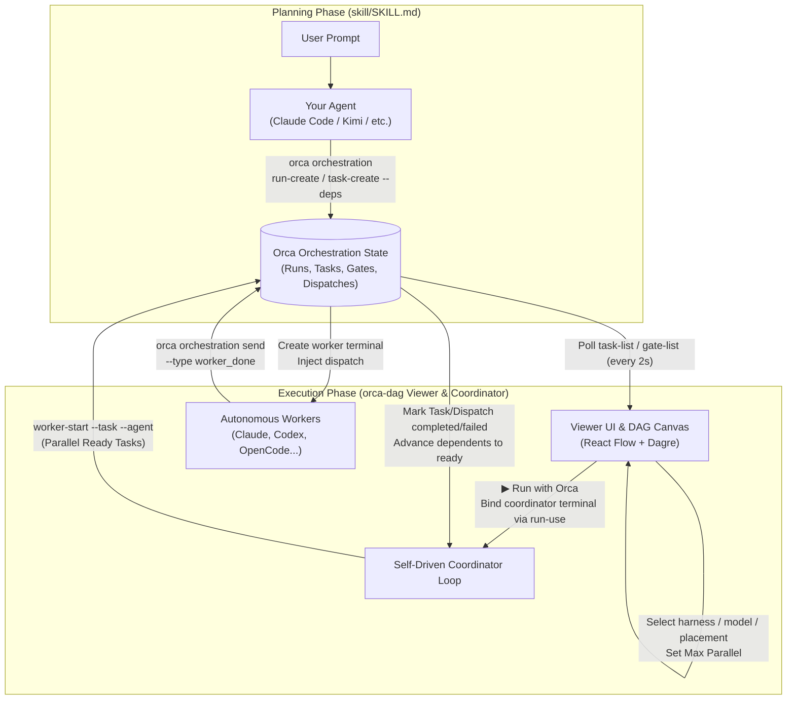

# Architecture and Coordination Reference

English | [简体中文](architecture_zh.md)

Back to [README](../../README.md) · [Documentation Index](../README.md)

This document details the system architecture, coordination lifecycle, authority model, safety mechanisms, and design boundaries of `orca-dag`.

---

## How It Works

The system cleanly separates **planning** from **visualization and execution**:

1. **The planning brain lives outside (`skill/SKILL.md`):** Your existing agent (Claude Code, Kimi, Cursor, etc.) reads the project workflow, resolves the active Orca CLI, consults the runtime-matched orchestration guide (`orca skills get orchestration`), and decomposes requirements into an Orca task DAG. There is no embedded Claude Agent SDK in the viewer.
2. **The viewer visualizes and coordinates (`server/` + `web/`):** Shipped as the `orca-orchestration-launcher` npm package and standalone binary. It connects to Orca's orchestration state over loopback CLI calls, renders the DAG live, allows per-node harness and placement configuration, and drives a self-contained coordinator loop.



### End-to-End Execution Flow

1. **Decomposition:** In your agent, prompt for a task decomposition. The agent creates a Run (`orca orchestration run-create`) and writes tasks and dependencies (`orca orchestration task-create --deps ...`).
2. **Polling and Layout:** The viewer polls `orca orchestration task-list --run <id> --json` every 2 seconds, calculates layout using Dagre or force-directed algorithms, and renders live status colors.
3. **Configuration:** Operators configure Default harness or per-node overrides (harness, model, effort, placement, lanes) and set Max parallel.
4. **Coordinator Loop:** Clicking **"▶ Run with Orca"** binds a dedicated coordinator terminal to the Run (`run-use --from <handle>`). On each tick, the coordinator queries ready tasks and calls `orca orchestration worker-start` in parallel up to the concurrency limit. Orca creates worker terminals, waits for readiness, injects dispatches, and returns Dispatch IDs (`ctx_*`).
5. **Settlement and Accounting:** Workers finish by sending `worker_done` (`orca orchestration send --type worker_done --outcome ...`). Orca marks the Task and Dispatch settled. The viewer archives worker output and executes an explicit terminal accounting decision: default **release**, immediate compatible **reuse** (`worker-start --terminal`), or **retain** on request. Dependents advance to `ready` until the graph is complete.
6. **Replanning:** If tasks or dependencies must change, the operator returns to the agent conversation to redraw the DAG in a fresh Run. Orca provides no API to edit or delete individual tasks in place.

---

## Run, Task, and Dispatch Layers

| Layer | What it is | Owned by | Persistence location |
|---|---|---|---|
| **Run** | Namespace and coordinator inbox; only one coordinator can be bound at a time (`consumer_generation` provides fencing). | Orca | Orca internal database |
| **Task** | A unit of work; `deps` define DAG edges, `run_id` scopes it to a Run. | Orca | Orca internal database |
| **Dispatch** | **One attempt** (`ctx_*`); tracks heartbeats, pane identity, capability credentials, and retry chains (`--retry-of`). | Orca | Orca internal database |
| **Viewer Preferences** | Per-node harness, model, effort, placement, lanes, lead stage, and canvas layout. | Viewer | `.orca-dag/config.json` |
| **Activity Journal** | Explanatory event timeline: starts, deliveries, check receipts, and agent transitions. Never authoritative over task settlement. | Viewer | `.orca-dag/activity.jsonl` |

> **Key Rule:** A Run is a namespace, **not a DAG**. Multiple disconnected graphs can coexist in a single Run. "One Run = one DAG" is a convention enforced by `skill/SKILL.md`, not an Orca constraint.

### Circuit Breaking and Retries (Orca 1.4.226+)

Orca 1.4.226 counts failed `worker-start` invocations along the exact `--retry-of` Dispatch chain:
- The **third** failed start marks the chain `circuit_broken`. Subsequent attempts are rejected with `task_not_startable`.
- A worker that successfully reaches `ready` and later reports `failed` does **not** increment this start-failure counter.
- Stopping/restarting the Run or restarting the viewer process **does not** reset the chain.
- Operators must retry the same Task in the same Run from its exact prior Dispatch, explicitly repeating intended placement parameters (since `--retry-of` does not inherit placement).
- Do not create replacement Tasks or Runs solely to bypass a circuit breaker.
- Standard recovery releases the failed terminal through Orca when ownership permits. User-takeover, explicitly retained, and structured sessions preserve their retain/release protections.
- Archived output remains readable through the exact Dispatch ID after terminal release.

---

## Coordinator Safety and Read Efficiency

- **FIFO Delivery Acknowledgements:** Every validated FIFO Delivery is acknowledged, including notifications and stale lifecycle messages. Pending questions or owed terminal decisions hold the ACK. Batches returned by `check --ack` are drained immediately without polling delay, reconciling between batches. Empty, error, or held batches retain the standard polling floor.
- **Cleanup Debt Reconciliation:** Reclaimable cleanup debt is rechecked against fresh fleet state on every cycle; external releases clear debt automatically. Unknown cleanup states remain blocking.
- **Helper Custody:** Workers created as helpers within the same Run remain under the custody of their active creator. The viewer verifies exact Dispatch lineage rather than inferring ownership from `parent_id`. Helpers are adopted only after positive creator settlement. Visible active workers consume concurrency admission budget, but external helpers mean **Max parallel is an admission throttle, not a hard runtime-wide cap**.
- **Terminal Reuse Preconditions:** Automatic terminal reuse requires fresh, exact, connected PTY evidence for the identical agent and workspace. Chat handles do not establish PTY proof. OpenCode workers always use fresh starts to prevent frontend and model drift.
- **In-Flight Read Deduplication:** Concurrent GET requests for DAG, Workers, Activity, and Health share identical in-flight CLI reads, scoped by Run and options. No stale-result caching is introduced; mutation preconditions always execute fresh reads.

---

## The Authority Model

Every orchestration call flows through `resolveRunScope`:

```
Reads (task-list, gate-list)  ---> Allowed without consumer binding (pass --run <id>)
Mutations (dispatch, gates)   ---> Requires active Run binding (--from <coordinator-handle>)
```

Because the viewer runs as an external OS process without an ambient Orca session, it creates and manages a dedicated coordinator terminal:
- **Terminal Title:** `orca-dag coordinator · <workspace-hash> · <instance-id>`.
- **Binding and Fencing:** Binding with `run-use --from <handle>` fences any prior coordinator (such as an agent chat terminal). The viewer prompts for explicit operator confirmation before taking over.
- **Handoff and Workers (1.4.242+):** Dispatched workers cannot bind their own or ancestor Run and cannot use `--takeover-legacy`. They communicate using the live preamble. Coordinators can yield or hand off to separate Runs cleanly.
- **Workspace Scoping:** The `<workspace-hash>` scopes the coordinator to a single real workspace path. Two viewers in different workspaces operate independently. A second viewer started in the **same** workspace refuses startup with `coordinator_conflict` (HTTP 409) rather than clobbering the existing coordinator.
- **Teardown:** On Stop or clean shutdown, the viewer closes its coordinator terminal and releases the Run binding.

---

## CLI and Workspace Resolution

CLI executable, workspace path, and execution capability are resolved **once at process startup** and remain immutable:

### Executable Resolution Order

1. `ORCA_CLI_COMMAND`: Exact executable and quoted argv parsed without a shell. Shell operators (`|`, `>`, `&&`, `$()`) are strictly rejected.
2. `orca-dev`: Used when `ORCA_DEV_REPO_ROOT` is defined.
3. `orca-ide`: Used on **Linux outside an Orca terminal** to prevent collision with GNOME's screen reader (`/usr/bin/orca`).
4. `orca`: Default standard executable on PATH.

Every execution runs via `spawn` with `shell: false` and the workspace directory as `cwd`.

### Workspace Resolution

`WORKSPACE_DIR` defaults to `process.cwd()`, verified for existence and resolved to its canonical real path (symlinks collapsed). It forms the Orca worktree selector `path:<WORKSPACE_DIR>`. An explicit `ORCA_WORKTREE` environment variable overrides this selector.

### Execution Enablement Gate

Checked via `GET /api/readiness`:
- **Orca ≥ 1.4.205:** Full execution enabled.
- **Orca 1.4.160–1.4.204:** **View-only mode**. The DAG, gates, and statuses render, but execution controls disable themselves, and mutating endpoints return `503 execution_disabled`.
- **Orca < 1.4.160 / Not Found:** Unsupported. Readiness reports the exact attempted CLI resolution and error.

---

## Code Layout

```text
skill/
  SKILL.md                 Thin project workflow: PRD → design → task DAG → viewer.
                           Delegates CLI syntax to `orca skills get orchestration`.

server/src/
  index.ts                 Process entry: CLI arguments, workspace resolution, loopback listener.
  app.ts                   Express app (createApp): API route definitions and SPA serving.
  activity.ts              Run-scoped event parser and bounded Activity journal.
  requestLedger.ts         Bounded mutation-request audit ledger (.orca-dag/requests.jsonl).
  security.ts              Security enforcement: loopback binding, mutation tokens, input validation.
  coordinator.ts           Self-driven coordinator loop: DAG polling, worker-start, placement, settlement.
  orca.ts                  Orca CLI wrapper: command invocation, version detection, discovery, gates.
  orca.test.ts             Unit tests for CLI resolution, readiness gates, and conflict detection.
  runHealth.ts             Run ownership and health diagnostics (viewer-owned / external / unbound).
  config.ts                Workspace configuration persistence (.orca-dag/config.json).
  workspaceState.ts        State file paths, migration from legacy root files, and safety fallbacks.
  skill.ts                 Automated installation of SKILL.md into local agent directories.
  planning.ts              Managed .gitignore block handling for .orca-dag/.
  uninstall.ts             Uninstallation logic: unlinks skills, closes stale coordinator terminals.
  webAssets.ts             Build-time asset loader for embedded frontend and skill assets.

web/src/
  App.tsx                  Main UI shell, 2-second polling loop, SVG crayon filter definitions.
  components/
    DagView.tsx            React Flow DAG canvas, custom node rendering, crayon animations.
    ExecControls.tsx       Toolbar: default harness, max parallel, Run/Stop controls, status indicators.
    NodePanel.tsx          Inspector: spec preview, lead-stage toggle, locked preferences, placement.
    PlacementEditor.tsx    Placement editor: 4 local modes, 2 remote modes, creation metadata.
    LanesPanel.tsx         Workspace lanes management: runtime state, diffs, and worktree removal.
    ActivityPanel.tsx      Real-time event timeline, filters, technical evidence inspection.
    ChatPanel.tsx          Stage-scoped conversation bubbles and live coordinator-check receipts.
    GatePanel.tsx          Approval gate buttons and cross-lane integration gates.
    RunPicker.tsx          Workspace-scoped Run selector, pagination cursor, and exact Run lookup.
    DoodleSelect.tsx       Accessible hand-drawn portal select component.
    WorkerPanel.tsx        Fleet view: liveness, output reader, search, download, stop/abandon/focus.
    RequestAuditPanel.tsx  Mutation request audit table with live request-show receipts.
  harness.ts               Reactive state store for preferences, hydrating from /api/config.
  placement.ts             Client-side placement grammar and lane preflight validation.
  layout.ts                Layout engines: Dagre layered (LR/TB) and Fruchterman–Reingold force-directed.
  types.ts / api.ts        Frontend data contracts and API client.

scripts/
  build-binary.mjs         Bundles Vite web assets + server into a standalone Bun binary.
  build-npm.mjs            Builds web assets and compiles server with esbuild for npm package.
  build-all-binaries.sh    Cross-compiles standalone binaries for all supported platforms.
  check-skill.mjs          Validates SKILL.md frontmatter and guards against CLI syntax drift.
  release.mjs              Automates versioning, tagging, and triggering CI release workflows.
```

---

## Design Notes and Boundaries

- **The Brain Lives Outside:** The viewer does not embed an LLM SDK. Planning is owned by your primary agent.
- **The Viewer is its Own Coordinator:** Orca deliberately does not provide an autonomous scheduler. The viewer coordinates task execution using Orca's primitive APIs (`worker-start`, `send`, `worker-stop`, `worker-release`).
- **Autonomous Workers Required:** Workers must have permission to execute commands and send `worker_done` without manual terminal prompts; otherwise execution stalls.
- **The Dispatch Inject Quirk:** On legacy terminal paths, `dispatch --inject` pastes text into the agent input box but may not submit. The coordinator waits ~2 seconds and issues a harmless trailing Enter.
- **OpenCode Launch Modes:**
  - Standard Auto: Uses native `opencode2` when no model override is provided (Orca ≥ 1.4.220).
  - Explicit Model in Auto: Uses native `opencode` model path on Orca ≥ 1.4.241.
  - Experimental Pinned Full TUI: Activated via `ORCA_DAG_OPENCODE_TUI=1` on Orca ≥ 1.4.222.
- **Exact Placement or Refusal:** Local execution supports exactly 4 modes (`current`, `exact-existing`, `new-child`, `new-top-level`); remote execution supports 2 modes (`exact-existing`, `new-top-level`). Invalid or ambiguous placement requests fail closed before invoking Orca.
- **Orca Owns Worktrees:** Worktrees are created exclusively via `worker-start` and removed exclusively via `orca worktree rm`. Direct Git commands or directory deletions are never used.
- **Immutability of Executed Tasks:** Orca provides no single-task edit, delete, or reset API (`reset --tasks` wipes all Runs globally). Plan modifications require generating a new DAG in a fresh Run.
