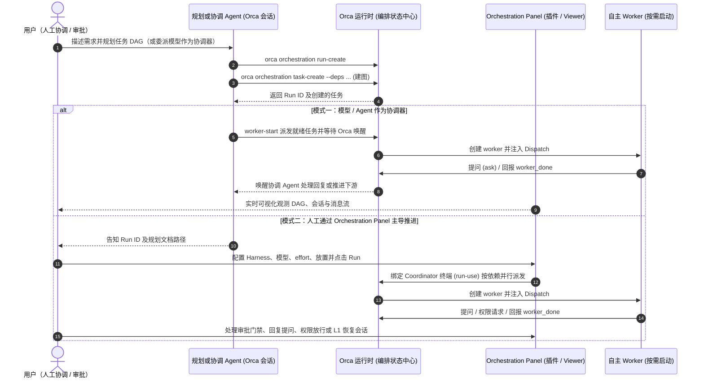

# 架构与设计规范

[English](architecture.md) | 简体中文

> [返回文档索引](../README_zh.md) · [返回 README](../../README_zh.md)

本参考文档详细阐述 orca-dag 的系统架构、状态与模型分层、协调者（coordinator）调度与安全机制、权限与 CLI 解析规则、代码布局以及关键设计边界。

## 工作原理与两种协调模式

Orca 编排与 **Orchestration Panel**（`orca-dag`）支持**两种互补的协调模式**，用户可按任务复杂度与信任边界自由选择，并在需要时显式交接协调权（`run-use` / `coordinatorControl`）：

1. **模型 / Agent 协调模式（在 Orca 中选定一个模型作为协调器）**：
   - 在 Orca 中选择一个模型/Agent 会话（如原生对话或终端 Agent）作为该 Run 的协调器，由模型自主规划 DAG、按 `task-list --ready` 并行派发与监督 Worker、响应 `ask` 提问并通过 `send` 追问或纠偏，直到全部任务落定后向用户汇报。
   - 该模式下，Orchestration Panel 作为实时可视化观测与审阅面板（只读展示拓扑、会话工具卡片与消息流，绝不隐式抢占协调权；仅当操作员显式确认接管时才执行一次性变更）。
2. **人工主导 + 编排面板推进模式（由人负责协调推动）**：
   - 规划阶段仍可由任意编码 Agent（加载 `orca-dag` skill）协助完成 PRD、技术设计与任务 DAG 写入；执行阶段由**人**通过 Orchestration Panel（原生 Orca 侧边栏插件或完整标签页工作台）主导推进。
   - 用户逐节点选定 Harness、模型、推理力度（`--effort`）及工作区放置/Lane，点击运行后由确定性规则调度循环沿 DAG 依赖并行派发就绪波次；审批门禁（Gate）、Worker 提问回复、单次权限弹窗放行/拒绝、手动停止/重试以及 L1 原生会话恢复均由人直接把关。

> **规划与执行边界**：无论采用哪种协调模式，查看器自身都**不内嵌 LLM / Agent SDK**——AI 规划或模型协调始终运行在用户所选的 Orca Agent 会话中，而查看器负责可视化、确定性波次调度与人工决策控制面。



典型人工主导推进流程如下：

1. **规划阶段**：用户在自己的编码 agent（如 Claude Code、Codex、Antigravity 等）中交流需求。agent 加载 `orca-dag` skill，使用与用户对话一致的语言创建 Run（`orca orchestration run-create`），并使用 `task-create --deps …` 将工作项和依赖关系写入 Orca 编排状态。
2. **可视化与插件阶段**：可通过 `npx orca-orchestration-launcher` 启动本地服务，或直接加载自包含原生 Orca 伴生插件（`orchestration-panel`，Host API 1.10 `trusted-worker`）。插件内置服务端（`server/index.mjs`）与前端（`panel/`）：当当前本地工作区未启动外部 viewer 终端时自动拉起隔离的回环服务（`PORT=0`、`NO_OPEN=1`、`ORCA_DAG_WEB_DIR`），工作区关闭或插件停用时自动回收。插件通过用户私有注册表发现外部 viewer；外部 viewer 关闭后切回内置后端。`agent.status.changed` 以及只读的 `agent.tool.after`、`agent.prompt.before` 仅以终端 ID 唤醒匹配的会话记录读取。插件还通过 `workspace.list` / `agent.listSessions` / `agent.resume` 支持 L1 原生会话恢复。
3. **执行准备**：在完整标签页（或侧边栏）中为各任务节点指定 harness（或使用全局默认 harness）、设置模型、effort 与 "Max parallel" 并发上限，然后点击 **「▶ Run with Orca」**。
4. **自驱动协调循环**：viewer 将自身专用终端绑定为该 Run 的 coordinator（获取写入调度权限），循环扫描所有 `ready` 状态的任务，通过 `orca orchestration worker-start --task <id> --agent <harness>` 并行启动 worker。Worker 执行完成后发送 `worker_done`，Orca 自动更新状态并解锁下游依赖。任务落定后，终端根据规则释放、复用或保留。
5. **重绘与迭代**：Orca 不提供修改单任务定义或依赖的原语。若需调整计划，返回 agent 对话中重新生成 DAG。

查看器将 v2 发现记录发布到 `~/.orca-dag-viewers/<规范化工作区路径的 SHA-256>.json`（POSIX 下目录权限 `0700`，文件权限 `0600`）。端口与签名密钥是私有运行时元数据，绝不属于工作区数据。可信插件派生 HTTP 桥接令牌，并验证 hello/inbox 响应签名；浏览器和操作者通过 [viewer API](http-api_zh.md#连接受信任的-viewer) 访问。旧版工作区端点文件不再用于发现，卸载时会将其移除。

## Run / Task / Dispatch 三层模型

| 层级 | 实体定位 | 维护方 | 作用与生命周期 |
|---|---|---|---|
| **Run** | 命名空间 + coordinator 收件箱 | Orca | 同一时刻仅允许一个绑定的 coordinator（使用 `consumer_generation` 实施 fencing 隔离）。Run 是命名空间，不等于单张 DAG（一个 Run 可包含多张不连通的图）。 |
| **Task** | 工作项定义 | Orca | 携带 `spec`、`title`、`deps`（定义 DAG 有向边）以及归属的 `run_id`。状态包括 `pending`、`ready`、`dispatched`、`completed`、`failed`、`blocked`。 |
| **Dispatch** | 单次执行尝试 | Orca | ID 形如 `ctx_*`。记录沿 `--retry-of` 链累计的失败次数、心跳、pane 身份及能力凭证。每次重试生成新的 Dispatch。 |
| **偏好与元数据** | 本地元数据 | Viewer | 记录每节点启动偏好、每 Run 主阶段、画布自定义坐标、默认参数等，持久化于 `.orca-dag/config.json`。 |
| **Activity 记录** | 诊断与解释历史 | Viewer | 记录回复、启动、清理裁决、新消息、错误和 agent 状态变化，持久化于 `.orca-dag/activity.jsonl`；绝不作为 Task 落定依据。 |

### 失败熔断机制

Orca 1.4.226 沿确切的 `--retry-of` 链累计启动失败的 `worker-start`：
- **熔断阈值**：连续第 3 次启动失败将 Dispatch 状态置为 `circuit_broken`，后续针对该任务的启动尝试将直接被 `task_not_startable` 拒绝。
- **不计入熔断的情况**：worker 成功就绪启动后，内部运行失败并通过 `worker_done` 自报 `failed`，不计入启动熔断计数。
- **熔断状态持久性**：点击 Stop/Run 或重启 viewer 均不会重置熔断链。恢复时必须在同一 Run 中针对同一 Task 重试确切的上一 Dispatch，并重新明确指定放置位置（`--retry-of` 不继承原放置参数）。严禁通过新建 Task 或 Run 来绕过熔断保护。
- **资源清理**：标准恢复会在 Orca 权限允许时释放归 viewer 所有的失败旧终端；被标记为用户接管（`user_takeover`）、显式归属或外部会话的终端继续受到 retain/release 保护，终端释放后归档 transcript 仍可查验。

## Coordinator 安全边界与读取效率

- **收件箱协议与版本术语**：官方公共编排契约为 `contract 1`（`orchestration.contract.v1`），运行时协议为 3，联盟生命周期结算协议为 3（`ORCHESTRATION_FEDERATION_LIFECYCLE_SETTLEMENT_PROTOCOL_VERSION`），控制邮件协议为 2；`orchestration.federation-lifecycle-settlement.v1` 为联盟结算能力标识。本地 V3 迁移与 `[orca-dag:merge-inputs-v3]` 握手标记为本地 viewer 契约/标记，非全局上游版本名；持久化标记切勿重命名。旧版 FIFO check 重放最旧未确认 Delivery；处理全部消息，并处理 ACK 返回的后续批次。消费式 check 在读取时确认，单独 ACK 不获取下一批。读取时的传输确认与本地处理完成严格区分：持久化消费式 check UUID、批次投递、已处理消息 ID、未决提问及操作员消息记录均保存在 `.orca-dag/sessions.json`（`mailboxChecks`、`guidanceSends`、`operatorMessages`）中并支持跨重启恢复。丢失的消费响应通过只读 `request-show` 依据原始请求身份恢复，绝不发起新变更。已确认批次在人工提问未落定时继续流转。`--peek` 仅用于观察；不要为了监控而消费 worker 的收件箱。
- **指导消息、后续任务生命周期与嵌套重定向**：产生原生影响前，先将请求及请求目标身份持久化到 `guidanceSends`。接受回执后区分请求与实际 Task/Dispatch ID、`enqueued` 与 `follow_up`；指导消息亦支持正面证实的嵌套重定向 `recipient_run_bound_redirect`，明确区分源 Task/Dispatch 与实际目标 Run（`destinationRunId`），不篡夺子所有权，不凭空生成 worker。账本记录 `creationProven` 及清洗后的不可变启动证据（`status`, `launchMode`）。未决指导占用并发配额并阻止盲目重发。只读调和先前操作时返回 `guidance_reconciled`，绝不将其当作新内容已投递。Run Stop 覆盖全部 viewer 拥有的后续根任务，并将未决发送或未知清理结果报告为显式债务。
- **Stop 事件与真实提问语义分离**：原生 `stopReason` 升级（`finished`, `errored`, `needs-input`, `exited`）作为事件记录在 `PendingInboxItem.kind === 'stop_event'` 中，与可回复提问（`kind === 'question'`）严格区分。其落定必须遵循精确 Dispatch 引导、操作员决断或权威结算，绝不伪造回复或合成成功。
- **历史启动模式读取**：Stop 或重启后，worker 详情可从关键账本恢复不可变的后续启动模式元组。必须匹配实际 Run、Task 与 Dispatch，不能误用请求目标父任务。证据缺失或不可读时仍为未知；展示证据恢复不授予变更权限。
- **已提交 Stage 合并握手**：要求跨工作区已提交代码交接的合并点必须同时声明 `[orca-dag:merge-prep]` 与 `[orca-dag:merge-inputs-v3]`。原生 1.4.247 `ask` 不提供 `--subject` 与 `--payload` 参数（原生 subject 固定为 `'Question'`，`payload.question` 包含完整提问文本）。worker 必须在任何 Git 修改前，发起提问文本严格且仅为 `[orca-dag:merge-inputs-v3]` 的提问。coordinator 在校验当前合并 Task/Dispatch 归属、发送方句柄及干净依赖后，通过 StageGit 返回不可变 commit SHA 回执。缺乏 V3 标记的旧可运行合并 spec 在建图校验时会被直接拒绝，须新建 Run 重新规划。
- **关键状态恢复与热降级防线**：`.orca-dag/sessions.json` 保存关键恢复账本（`mailboxChecks`、`guidanceSends`、`operatorMessages` 与 `resumeAttempts`），不是滚动审计日志。非活跃 Run 的操作员消息在调用原生接口前先落盘 UUID、内容哈希及作用域，结果未知时按原请求标识执行只读 `request-show`。原生会话恢复记录 `prepared`、`resumed_terminal` 及最终的 `bound`、`refused` 或 `unknown`；结果未知时保持 Task 暂停。升级前先停止独立 viewer 和插件内置后端；恢复账本仍有未决项时不要热降级。
- **恢复账本并发写入**：共享本地文件系统及 PID 命名空间的独立 viewer 和内置后端会串行执行 `sessions.json` 的读改写。持有者仍活跃或状态不明时，等待超时即拒绝写入，不按锁龄强行接管。下次写入时清理已确认退出的进程留下的锁声明和暂存文件。旧版 viewer 不遵守此锁。
- **服务端统一 `OutputTail` SSE 与插件 Hook 加速**：`server/src/outputTail.ts` 按 Run、Dispatch 和输出来源，在 SSE 订阅者（`/api/workers/:dispatchId/output/stream`）之间共享上游 `worker-read` 轮询器。`server/src/pluginBridge.ts` 仅使用 Agent 状态、工具和提示词事件的终端 ID 唤醒匹配的轮询，不把事件当作输出或会话身份依据。**会话**卡片来自精确限定范围的原生会话记录；工具输入输出预览和提示词内容不会经过桥接。
- **清理债务与不完整远程观测**：可回收的清理债务（reclaimable debt）严格根据新鲜的 fleet 记录重新核验，在 viewer 外部完成的 release 同样能抵消旧债务。`listWorkers` 返回有类型的 `WorkerInventory`（`{ workers: OrcaWorkerRow[], partialHostErrors: unknown[] }`），跨页汇总保留 `partialHostErrors`；远端主机缺失代表证据不全，绝不误判为已退出或借此清除债务。工作树移除清理安全判定重新核验全局完整 fleet 列表（`listWorkers(undefined, { includeRemote: true })`）而非仅当前选定 Run，确保未在终端列表中登记的其他 Run Native Chat worker 依然能有效保护共享工作区免遭误删。
- **Helper 管理与谱系隔离**：同 Run 内的 helper worker 严格归其活动创建者管理。viewer 读取精确的 Dispatch lineage，不将 `parent_id` 视为所有权；仅在证实创建者已落定后方才接管 helper，归属不可读时保持等待。Stop 命令如实报告委派工作，绝不擅自终止它。可见的活动 worker 占用派工预算，但 helper 可在 viewer 外部启动，因此 **Max parallel 不是整个 Orca 运行时的全局硬上限**。
- **协调权交接限制**：一次性变更要求操作员确认已观察到的协调者句柄和消费代次。当前 Orca `run-use` 不支持传入预期代次，无法跨进程以原子方式比较并更换绑定；不要并发接管同一个 Run。
- **终端精确复用**：自动终端复用必须具备相同 agent、相同工作区且新鲜、已连接的 PTY 证据。仅凭 Chat handle 不能证明 PTY 存活；OpenCode、OMP、Antigravity 因需保留前端、新会话与模型身份，均不参与通用复用。
- **作用域限定操作与并发读取共享**：Worker 输出、释放和保留严格限制在选定 Run 范围内（GET 用 `run` 查询参数，变更用 `runId` 请求体）。未限定作用域的请求审计保持可用。DAG、Workers、Activity、Health 的并发 GET 请求共享底层读取，严格按 Run 和参数隔离。页面隐藏时（`document.visibilityState === 'hidden'`）暂停 Activity 事件流连接，重新可见时刷新重连，保留轨道收起期间的未读计数。展示缓存绝不作为最终变更管辖权凭据。

## 权限模型：为什么 viewer 要占一个终端

Orca 对所有编排 API 的调用均通过 `resolveRunScope` 进行权限校验：

- **只读操作**（`task-list` / `gate-list`）：只要显式携带 `--run <id>` 参数即绕过 consumer 校验，**任何本地进程均可无条件读取**。viewer 的日常状态轮询仅依赖此特性。
- **写与协调操作**（`dispatch` / `gate-resolve` / `task-create` 以及 `worker-start`）：强制要求调用者绑定当前 Run。Orca 原生聊天界面使用会话内部身份；外部 viewer 则通过 `--from <handle>` 使用绑定的终端身份。
- **终端命名与工作区 Hash 隔离**：viewer 启动协调时会创建标题形如 `orca-dag coordinator · <workspace-hash> · <instance-id>` 的专属终端，并执行 `run-use` 绑定。标题中的 `<workspace-hash>` 保证不同工作区的 viewer 各自管理自己的终端，互不干扰；若第二个 viewer 试图连接**同一工作区**，服务端直接返回 `409 coordinator_conflict`，绝不发生静默抢占或误关已有终端。
- **Fencing 机制与显式变更确认**：`run-use` 绑定会触发版本递增，原 coordinator 会被权限隔离。对未处于当前 viewer 活跃调度下的 Run 发起一次性变更（`asCoordinator`）时，强制要求提供与当前 Run 绑定匹配的显式控制确认（`coordinatorControl: { confirmed: true, coordinatorHandle: string | null, consumerGeneration: number | null }`），否则报 `409 coordinator_control_required`。绝不隐式夺权或静默绑定临时终端。若需交回控制权，有资格的协调者可在其终端执行 `run-use` 重新恢复绑定。
- **Worker 边界（Orca ≥ 1.4.242）**：已派工的 worker 禁止绑定自身或祖先 Run，亦不能使用 `--takeover-legacy`；其收信与回报遵循当前有效的 preamble。停止执行时，viewer 会主动关闭其专有协调者终端，将 Run 资源安全让出。

## CLI 解析、工作区与执行能力判定

CLI 与工作区在启动时解析一次；执行就绪情况会重新探测，仅对同一已解析运行时短暂缓存，不是永久的启动判定：

1. **可执行文件解析顺序**：
   - 若设置了 `ORCA_CLI_COMMAND`，使用其精确解析出的带引号 argv 参数。**严禁通过 shell 执行**，参数中包含管道 `|`、重定向 `>`、子 shell `$()` 或未转义 `$` 时将被直接拒绝，防止注入漏洞。
   - 若设置了 `ORCA_DEV_REPO_ROOT`，选用 `orca-dev`。
   - **在 Linux 环境下且不在 Orca 管理的终端内部**时，自动选用 `orca-ide`（避免误调 Linux 系统自带的 GNOME 读屏软件 `/usr/bin/orca`）。
   - 其余情况默认调用 `orca`。
   - 所有子进程调用均遵循 `shell: false`，工作目录设为解析后的真实工作区。
2. **工作区解析**：
   - 检查 `WORKSPACE_DIR`（默认当前目录）是否存在，并解析其**规范真实物理路径**（symlink 会被归一化到目标路径）。
   - 该路径转换为精确的 worktree 选择器 `path:<WORKSPACE_DIR>`。在目录 A 启动但指定 `WORKSPACE_DIR=/abs/B` 时，coordinator 与 worker 都将置于目录 B。显式声明的 `ORCA_WORKTREE` 拥有最高优先级。
3. **执行能力门槛判定（`GET /api/readiness`）**：
   - **执行门槛**：CLI ≥ 1.4.205，且所选运行时明确处于 ready、稳定 appVersion ≥ 1.4.205；新 CLI 本身不足以证明可以执行。
   - **只读模式**：运行时过旧、未知、断连或启动中时禁用执行并返回 `503 execution_disabled`，仍保留可用的读取操作。
   - 未找到有效 CLI 时，readiness 接口如实返回尝试过的解析路径与错误原因。

## 代码结构

```text
skill/SKILL.md            薄项目工作流：PRD → 技术设计 → 任务 DAG → viewer；命令规范委托运行时指南
server/src/
  index.ts               进程入口：参数解析、CLI 与工作区探测、发布私有注册记录、skill 与 .gitignore 初始化、回环监听
  app.ts                 Express API 应用路由、插件桥接路由、OutputTail SSE、L1 原生恢复与静态 SPA 托管（`ORCA_DAG_WEB_DIR`）
  pluginBridge.ts        插件鉴权（`x-orca-plugin-token`）、hello/inbox 响应签名、终端 ID 唤醒与命令收件/回执
  outputTail.ts          服务端统一 `OutputTailManager` SSE：复用精确限定范围的 `worker-read` 轮询，并按终端 ID 提前唤醒
  nativeResume.ts        核验本地工作区和 Provider 的精确会话历史，只打开并绑定新面板，记账至 `sessions.json`
  activity.ts            Run 作用域事件解析与有界 Activity 日志流
  requestLedger.ts       变更请求持久化账本（.orca-dag/requests.jsonl）与 request-show 对账
  providerSessions.ts    持久化 sessions.json 存储：管理会话绑定、mailboxChecks、guidanceSends、operatorMessages 与 resumeAttempts
  operatorMessages.ts    非活跃操作员提问回复与群发消息助手，带 sessions.json 预落盘与只读恢复
  taskGuidance.ts        主动 worker 指导消息、带类型回执与只读恢复
  stageGit.ts            Git Stage 提交证据、不可变基准快照与合并输入握手
  security.ts            回环安全策略：进程级 mutation token、参数校验、自定义命令放行开关
  coordinator.ts         自驱动调度器循环：DAG 轮询、worker 派发、放置/lane 映射、集成门与终端生命周期
  orca.ts                orca CLI 底层调用封装（shell: false）、能力嗅探、工作区与环境发现、worker 交互与 `openOrcaViewerTab` 智能标签页复用/复活
  orca.test.ts           CLI 解析、就绪性判断与冲突处理的测试覆盖（fake orca 桩）
  runHealth.ts           Run 归属与健康度判定（viewer-owned / external / unbound / inconsistent）
  config.ts              本地偏好配置持久化（.orca-dag/config.json）
  workspaceState.ts      统一状态路径管理、旧版根目录文件平滑迁移与只读回退
  skill.ts               将 skill/SKILL.md 自动安装至系统已检测到的所有 coding agent
  planning.ts            管理工作区 .gitignore 中的 .orca-dag/ 忽略规则（兼顾旧版 .orca/ 块）
  uninstall.ts           实现 orca-dag uninstall：反向卸载 skill、清理私有注册记录、旧版工作区端点文件与受管忽略规则、回收残留终端
  webAssets.ts           编译期内嵌前端资源与 skill 文件的内存加载器
plugin/
  orca-plugin.json       原生 Orca 插件清单（`orchestration-panel`，Host API 1.10 `trusted-worker`）
  icon.png               自定义分叉汇聚 DAG 插件图标
  src/worker.ts          受信任 Worker 入口：端点发现、自托管内置服务自动拉起与故障切换、API/SSE 代理、Hook、状态栏与 `agent.resume`
  src/protocol.ts        Frame / Worker 共享协议（`orca-dag.api`、`orca-dag.activity`、`orca-dag.output`）
web/src/
  main.tsx               双形态入口：按 `?view=sidebar` 懒加载 `SidebarApp` 或完整工作台 `App`
  App.tsx                四区双主题黑白灰 IDE 工作台外壳、URL Hash 路由、2 秒轮询、执行防护
  bridge/orcaBridge.ts   双模式传输层：完整标签页直连 HTTP/SSE，侧边栏通过 Orca 插件帧代理请求与事件推送
  components/
    SidebarApp.tsx       精简右侧栏伴生界面（任务 / 待处理 / 活动），任务详情复用 `ChatPanel`（`embeddedMessagesOnly`）、`NodeSessionPanel` 与 `WorkerOutputDockView`
    NodeSessionPanel.tsx 从 `OutputTail` SSE 的原生会话记录帧生成可折叠工具调用卡片和轮次
    DagBrandMark.tsx     自定义分叉汇聚 DAG 品牌图标
    DagView.tsx          懒加载 React Flow DAG 画布，280x120 节点渲染，受控脉冲动效，静态连线
    ExecControls.tsx     Header 顶栏传送动作组（Run/Stop）与 Settings 分节启动参数配置面板
    NodePanel.tsx        任务详情与配置面板：只读 spec 预览、主阶段标记、启动参数覆盖、放置编辑器与审批门创建
    PlacementEditor.tsx  4 种本地放置模式与 2 种远程放置模式编辑器及校验
    LanesPanel.tsx       Workspace lanes 运行时状态、代码审阅入口与显式移除
    ActivityPanel.tsx    实时事件时间线（单条共享 SSE 连接）、技术证据展开与上下文操作
    ChatPanel.tsx        Run 群聊与 Task 私聊共用消息，显式 @Task 发送，支持 `embeddedMessagesOnly` 供侧边栏复用
    MailboxChecks.tsx    独立有界的收件检查证据、投递/重放分组与原始回执详情
    HarnessAvatar.tsx    本地官方 harness 图标、来源/许可说明与未知类型的中性图标
    useScopedChatState.ts 作用域草稿和回执；同一 Task 在不同聊天视图共享繁忙/未知发送保护
    GatePanel.tsx        审批门与跨 lane 集成门决策卡片
    GateInspector.tsx    右侧上下文审批门检视面板
    RunPicker.tsx        Run 切换器、游标分页加载与精确 ID 查找
    WorkerPanel.tsx      Fleet 状态视图、来源标记输出、L1 原生会话恢复控件、搜索、日志下载与终端生命周期控制
    WorkerOutputDockView.tsx 底部坞与侧边栏共享的原始输出流查看器（基于 `OutputTail` SSE）
    RequestAuditPanel.tsx 变更请求审计面板，集成 request-show 实时状态探测
  harness.ts             响应式配置 store（与 /api/config 同步）
  placement.ts           客户端放置与 lane 规则预检逻辑
  layout.ts              DAG 布局算法：dagre 分层（横向/纵向，280x120 节点）
  types.ts / api.ts      前端核心类型与 API 客户端请求封装
  styles/ide-workbench.css 四区双主题（浅色/深色）黑白灰 IDE 工作台与紧凑聊天样式
  components/sidebar-app.css 精简侧边栏布局、容器查询与深浅色对比度令牌
  components/node-session.css 可折叠会话工具卡片与时间线样式
scripts/
  build-plugin-panel.mjs 构建插件侧边栏 SPA（`plugin/panel/`）与内置服务端（`plugin/server/index.mjs`）
  build-plugin.mjs       打包自包含零依赖原生 Orca 插件到 `dist-plugin/`
  build-binary.mjs       打包流程：前端构建 → 资源内嵌 → bun compile 生成单文件独立二进制
  build-npm.mjs          前端构建 + esbuild 服务端打包 → 生成 dist-npm/ 发布包
  build-all-binaries.sh  全平台目标交叉编译脚本（Linux/macOS/Windows 各架构）
  check-skill.mjs        SKILL.md 元数据校验，防止硬编码 CLI 指引脱离运行时指南
  release.mjs            发布自动化：版本校验、打 tag、推送，驱动 GitHub Actions 发布
```

## 设计说明与系统边界

1. **大脑外移**：规划决策完全由开发者使用的成熟 agent 承担（skill 提供严密规范），viewer 内部严禁内嵌 Claude Agent SDK 或替代用户做任务拆解。
2. **自驱动调度**：Orca 官方设计原则明确指出 *"Agents still choose placement and concurrency; Orca does not schedule workers."* 调度循环归 viewer 负责，但循环中的每一项操作均严格调用 Orca 原生 Run/Task/Dispatch 原语。
3. **自主 Worker 假设**：实现全自动无人值守执行的前提，是 worker 能够自主执行并在结束时发送 `worker_done --outcome`。若缺少免审批开关或未自主回报，流程将停滞于人工授权。
4. **Legacy 注入的提交竞态**：仅在 legacy `dispatch --inject` 路径中，coordinator 等待约 2 秒后补发一次 Enter（已提交或空输入时为无害 no-op）。原生 worker 的就绪与提交由 Orca 负责，不追加 Enter 重试。
5. **放置要么精确，要么不发生**：
   - 4 种本地放置模式与 `worker-start --worktree` 精确映射（`current`、精确已有选择器、`new-child`、`new-top-level --repo <精确repo>`）。新建工作树的创建类参数（`--name`、`--base-branch`、`--setup` 等）**仅允许**在新建模式下出现，已有工作区严禁重跑 setup。
   - 远程放置仅支持**精确已有工作区**或**新建顶层工作树**，远程 `current` 与 `new-child` 因跨主机语义模糊而在 HTTP 边界直接拒绝。
   - 拒绝一切隐式回退：新建 worktree 失败绝不静默降级到当前目录运行；重试仅使用经正向验证的已有工作区选择器。
6. **Legacy Harness 放置边界**：一次性 opencode 及自定义命令走 legacy 本地终端路径，无法支持非 current 工作区。与非 current 放置或 lane 搭配时，在创建终端前拒绝，不回退到当前目录。
7. **Worktree 归属 Orca**：所有隔离工作树均由 `worker-start` 随同 worker 创建；工作树移除必须针对精确选择器调用 `orca worktree rm`，且必须满足 worker 归属落定与用户显式确认。代码中绝不调用原生 `git worktree` 或直接删除文件系统目录。
8. **意图与状态分离**：`.orca-dag/config.json` 保存用户的启动选择和 lane 规划等意图，不将已创建的工作树 ID、终端 handle 或 Dispatch ID 持久化为配置事实；运行时身份从 Orca 响应中恢复。
9. **任务结构不可变性**：Orca 的 `task-update` 仅能修改任务状态和结果，不存在修改任务标题、spec 或依赖关系的接口，亦不存在删除单个任务的命令。需要修改任务结构时，**必须在 agent 中新建 Run 重新绘制 DAG**。
