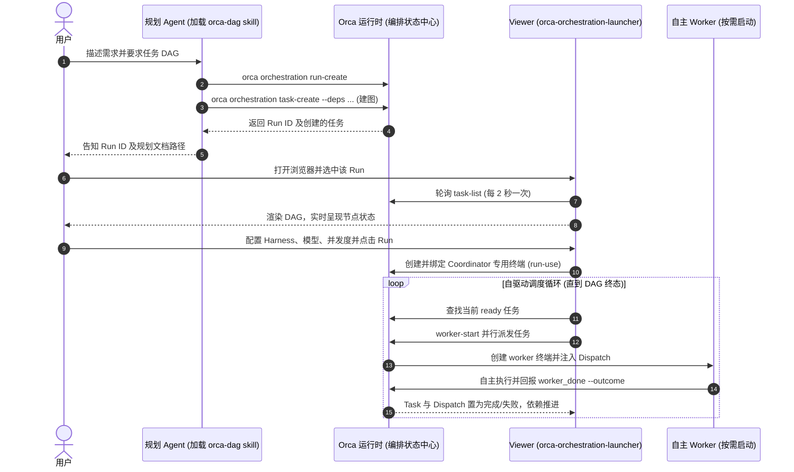

# 架构与设计规范

[English](architecture.md) | 简体中文

> [返回文档索引](../README_zh.md) · [返回 README](../../README_zh.md)

本参考文档详细阐述 orca-dag 的系统架构、状态与模型分层、协调者（coordinator）调度与安全机制、权限与 CLI 解析规则、代码布局以及关键设计边界。

## 工作原理

orca-dag 坚持「大脑在外，调度自驱」的原则，将「与 agent 规划沟通」和「可视化与执行」解耦：



1. **规划阶段**：用户在自己的编码 agent（如 Claude Code）中交流需求。agent 加载 `orca-dag` skill，创建 Run（`orca orchestration run-create`），并使用 `task-create --deps …` 将工作项和依赖关系写入 Orca 编排状态。
2. **可视化阶段**：打开 viewer（`npx orca-orchestration-launcher`）。顶栏下拉框选择 Run，viewer 每 2 秒轮询一次 `orca orchestration task-list --run <id> --json`，通过 dagre 计算层级布局，使用 React Flow 实时渲染状态变化。
3. **执行准备**：在 viewer 中为各任务节点指定 harness（或使用全局默认 harness）、设置模型与 "Max parallel" 并发上限，然后点击 **「▶ Run with Orca」**。
4. **自驱动协调循环**：viewer 将自身专用终端绑定为该 Run 的 coordinator（获取写入调度权限），循环扫描所有 `ready` 状态的任务，通过 `orca orchestration worker-start --task <id> --agent <harness>` 并行启动 worker。Worker 执行完成后发送 `worker_done`，Orca 自动更新状态并解锁下游依赖。任务落定后，终端根据规则释放、复用或保留。
5. **重绘与迭代**：Orca 不提供修改单任务定义或依赖的原语。若需调整计划，返回 agent 对话中重新生成 DAG。

## Run / Task / Dispatch 三层模型

| 层级 | 实体定位 | 维护方 | 作用与生命周期 |
|---|---|---|---|
| **Run** | 命名空间 + coordinator 收件箱 | Orca | 同一时刻仅允许一个绑定的 coordinator（使用 `consumer_generation` 实施 fencing 隔离）。Run 是命名空间，不等于单张 DAG（一个 Run 可包含多张不连通的图）。 |
| **Task** | 工作项定义 | Orca | 携带 `spec`、`title`、`deps`（定义 DAG 有向边）以及归属的 `run_id`。状态包括 `pending`、`ready`、`dispatched`、`completed`、`failed`、`blocked`。 |
| **Dispatch** | 单次执行尝试 | Orca | ID 形如 `ctx_*`。记录沿 `--retry-of` 链累计的失败次数、心跳、pane 身份及能力凭证。每次重试生成新的 Dispatch。 |
| **偏好与元数据** | 本地元数据 | Viewer | 记录每节点启动偏好、每 Run 主阶段、画布自定义坐标、默认参数等，持久化于 `.orca-dag/config.json`。 |
| **Activity 记录** | 诊断与解释历史 | Viewer | 记录回复、启动、清理裁决、新消息、错误和 agent 状态变化，持久化于 `.orca-dag/activity.jsonl`；绝不作为 Task 落定依据。 |

### 失败熔断机制

Orca 1.4.226 沿确切的 `--retry-of` 链累计启动失败的 `worker-start`：
- **熔断阈值**：连续第 3 次启动失败将 Dispatch 状态置为 `circuit_broken`，后续针对该任务的启动尝试将直接被 `task_not_startable` 拒绝。
- **不计入熔断的情况**：worker 成功就绪启动后，内部运行失败并通过 `worker_done` 自报 `failed`，不计入启动熔断计数。
- **熔断状态持久性**：点击 Stop/Run 或重启 viewer 均不会重置熔断链。恢复时必须在同一 Run 中针对同一 Task 重试确切的上一 Dispatch，并重新明确指定放置位置（`--retry-of` 不继承原放置参数）。严禁通过新建 Task 或 Run 来绕过熔断保护。
- **资源清理**：标准恢复会在 Orca 权限允许时释放归 viewer 所有的失败旧终端；被标记为用户接管（`user_takeover`）、显式归属或外部会话的终端继续受到 retain/release 保护，终端释放后归档 transcript 仍可查验。

## Coordinator 安全边界与读取效率

- **FIFO 投递确认**：每个通过验证的 FIFO Delivery 均会被 ACK 确认，包括常规通知及过期生命周期报告。未回复的问题及尚未落定的终端归属决策将阻止 ACK。`check --ack` 批次处理时，后续有数据批次不再额外等待轮询节流；空批次、错误或未解决批次则保留轮询节流保护。
- **清理债务核验**：可回收的清理债务（reclaimable debt）严格根据新鲜的 fleet 记录重新核验，在 viewer 外部完成的 release 同样能抵消旧债务；未知的清理结果将持续阻止标记完成。
- **Helper 管理与谱系隔离**：同 Run 内的 helper worker 严格归其活动创建者管理。viewer 读取精确的 Dispatch lineage，不将 `parent_id` 视为所有权；仅在证实创建者已落定后方才接管 helper，归属不可读时保持等待。Stop 命令如实报告委派工作，绝不擅自终止它。可见的活动 worker 占用派工预算，但 helper 可在 viewer 外部启动，因此 **Max parallel 不是整个 Orca 运行时的全局硬上限**。
- **终端精确复用**：自动终端复用必须具备相同 agent、相同工作区且新鲜、已连接的 PTY 证据。仅凭 Chat handle 不能证明 PTY 存活；OpenCode 实例因需保留指定模型及 session 归属，不参与通用复用。
- **并发读取共享与免缓存**：DAG、Workers、Activity、Health 的并发 GET 请求在底层 task/fleet/gate 读取未完成时共享请求，并严格按 Run 和参数隔离。不引入过期结果缓存，关键操作的前置检查始终强制读取最新证据。

## 权限模型：为什么 viewer 要占一个终端

Orca 对所有编排 API 的调用均通过 `resolveRunScope` 进行权限校验：

- **只读操作**（`task-list` / `gate-list`）：只要显式携带 `--run <id>` 参数即绕过 consumer 校验，**任何本地进程均可无条件读取**。viewer 的日常状态轮询仅依赖此特性。
- **写与协调操作**（`dispatch` / `gate-resolve` / `task-create` 以及 `worker-start`）：强制要求调用者绑定当前 Run。Orca 原生聊天界面使用会话内部身份；外部 viewer 则通过 `--from <handle>` 使用绑定的终端身份。
- **终端命名与工作区 Hash 隔离**：viewer 启动协调时会创建标题形如 `orca-dag coordinator · <workspace-hash> · <instance-id>` 的专属终端，并执行 `run-use` 绑定。标题中的 `<workspace-hash>` 保证不同工作区的 viewer 各自管理自己的终端，互不干扰；若第二个 viewer 试图连接**同一工作区**，服务端直接返回 `409 coordinator_conflict`，绝不发生静默抢占或误关已有终端。
- **Fencing 机制**：`run-use` 绑定会触发版本递增，原 coordinator（无论是开发者的 agent 终端还是原生聊天）会被权限隔离（fenced）。若需交回控制权，有资格的协调者可在其终端执行 `orca orchestration run-use --id <run>` 重新恢复绑定。
- **Worker 边界（Orca ≥ 1.4.242）**：已派工的 worker 禁止绑定自身或祖先 Run，亦不能使用 `--takeover-legacy`；其收信与回报遵循当前有效的 preamble。停止执行时，viewer 会主动关闭其专有协调者终端，将 Run 资源安全让出。

## CLI 解析、工作区与执行能力判定

所有基础环境判定均在 **viewer 启动时一次性解析**，存活期内不可变：

1. **可执行文件解析顺序**：
   - 若设置了 `ORCA_CLI_COMMAND`，使用其精确解析出的带引号 argv 参数。**严禁通过 shell 执行**，参数中包含管道 `|`、重定向 `>`、子 shell `$()` 或未转义 `$` 时将被直接拒绝，防止注入漏洞。
   - 若设置了 `ORCA_DEV_REPO_ROOT`，选用 `orca-dev`。
   - **在 Linux 环境下且不在 Orca 管理的终端内部**时，自动选用 `orca-ide`（避免误调 Linux 系统自带的 GNOME 读屏软件 `/usr/bin/orca`）。
   - 其余情况默认调用 `orca`。
   - 所有子进程调用均遵循 `shell: false`，工作目录设为解析后的真实工作区。
2. **工作区解析**：
   - 检查 `WORKSPACE_DIR`（默认当前目录）是否存在，并解析其**规范真实物理路径**（symlink 会被归一化到目标路径）。
   - 该路径转换为精确的 worktree 选择器 `path:<WORKSPACE_DIR>`。在目录 A 启动但指定 `WORKSPACE_DIR=/abs/B` 时，coordinator 与 worker 都将置于目录 B。显式声明的 `ORCA_WORKTREE` 拥有最高优先级。
3. **执行能力门槛判定（`GET /api/readiness`）**：
   - **Orca ≥ 1.4.205**：具备完整的 supervised worker 执行能力，开放全部 Run 与调度控制。
   - **Orca 1.4.160–1.4.204**：降级为只读模式。DAG、审批门与状态正常渲染，但 Run/Gate 控件禁用并提示升级；绕过界面直接发起变更请求将收到 `503 execution_disabled`。
   - 未找到有效 CLI 时，readiness 接口如实返回尝试过的解析路径与错误原因。

## 代码结构

```text
skill/SKILL.md            薄项目工作流：PRD → 技术设计 → 任务 DAG → viewer；命令规范委托运行时指南
server/src/
  index.ts               进程入口：参数解析、CLI与工作区探测、skill与.gitignore初始化、回环监听
  app.ts                 Express API 应用路由与静态 SPA 托管
  activity.ts            Run 作用域事件解析与有界 Activity 日志流
  requestLedger.ts       变更请求持久化账本（.orca-dag/requests.jsonl）与 request-show 对账
  security.ts            回环安全策略：进程级 mutation token、参数校验、自定义命令放行开关
  coordinator.ts         自驱动调度器循环：DAG 轮询、worker 派发、放置/lane 映射、集成门与终端生命周期
  orca.ts                orca CLI 底层调用封装（shell: false）、能力嗅探、工作区与环境发现、worker 交互
  orca.test.ts           CLI 解析、就绪性判断与冲突处理的测试覆盖（fake orca 桩）
  runHealth.ts           Run 归属与健康度判定（viewer-owned / external / unbound / inconsistent）
  config.ts              本地偏好配置持久化（.orca-dag/config.json）
  workspaceState.ts      统一状态路径管理、旧版根目录文件平滑迁移与只读回退
  skill.ts               将 skill/SKILL.md 自动安装至系统已检测到的所有 coding agent
  planning.ts            管理工作区 .gitignore 中的 .orca-dag/ 忽略规则（兼顾旧版 .orca/ 块）
  uninstall.ts           实现 orca-dag uninstall：反向卸载 skill、清理忽略规则、回收残留终端
  webAssets.ts           编译期内嵌前端资源与 skill 文件的内存加载器
web/src/
  App.tsx                应用外壳、2秒轮询、蜡笔手绘 SVG filter 滤镜定义
  components/
    DagView.tsx          基于 React Flow 的 DAG 画布，支持状态变色、harness 徽章与蜡笔涂鸦动画
    ExecControls.tsx     默认 harness、最多并行数、Run/Stop 控制与状态条
    NodePanel.tsx        任务详情只读 spec、主阶段标记、启动参数覆盖与放置编辑器
    PlacementEditor.tsx  4 种本地放置模式与 2 种远程放置模式编辑器及校验
    LanesPanel.tsx       Workspace lanes 运行时状态、代码审阅入口与显式移除
    ActivityPanel.tsx    实时事件时间线、技术证据展开与上下文操作
    ChatPanel.tsx        阶段会话与实时 coordinator check 流
    GatePanel.tsx        审批门与跨 lane 集成门决策卡片
    RunPicker.tsx        Run 切换器、新建 Run、游标分页加载与精确 ID 查找
    DoodleSelect.tsx     手绘蜡笔风格下拉选择组件
    WorkerPanel.tsx      Fleet 状态视图、来源标记输出、搜索、日志下载与终端生命周期控制
    RequestAuditPanel.tsx 变更请求审计面板，集成 request-show 实时状态探测
  harness.ts             响应式配置 store（与 /api/config 同步）
  placement.ts           客户端放置与 lane 规则预检逻辑
  layout.ts              DAG 布局算法：dagre 分层（横向/纵向）与 Fruchterman–Reingold 力导向
  types.ts / api.ts      前端核心类型与 API 客户端请求封装
scripts/
  build-binary.mjs       打包流程：前端构建 → 资源内嵌 → bun compile 生成单文件独立二进制
  build-npm.mjs          前端构建 + esbuild 服务端打包 → 生成 dist-npm/ 发布包
  build-all-binaries.sh  全平台目标交叉编译脚本（Linux/macOS/Windows 各架构）
  check-skill.mjs        SKILL.md 元数据校验，防止硬编码 CLI 指引脱离运行时指南
  release.mjs            发布自动化：版本校验、打 tag、推送，驱动 GitHub Actions 发布
```

## 设计说明与系统边界

1. **大脑外移**：规划决策完全由开发者使用的成熟 agent 承担（skill 提供严密规范），viewer 内部严禁内嵌 Claude Agent SDK 或替代用户做任务拆解。
2. **自驱动调度**：Orca 官方设计原则明确指出 *"Agents still choose placement and concurrency; Orca does not schedule workers."* 调度循环归 viewer 负责，但循环中的每一项操作均严格调用 Orca 原生 Run/Task/Dispatch 原语。
3. **自主 Worker 假设**：实现全自动无人值守执行的前提，是 worker 能够自主执行并在结束时发送 `worker_done --outcome`。若缺少免审批开关或未自主回报，流程将停滞于人工授权。
4. **Legacy 注入的提交竞态**：仅在 legacy `dispatch --inject` 路径中，coordinator 等待约 2 秒后补发一次 Enter（已提交或空输入时为无害 no-op）。原生 worker 的就绪与提交由 Orca 负责，不追加 Enter 重试。
5. **放置要么精确，要么不发生**：
   - 4 种本地放置模式与 `worker-start --worktree` 精确映射（`current`、精确已有选择器、`new-child`、`new-top-level --repo <精确repo>`）。新建工作树的创建类参数（`--name`、`--base-branch`、`--setup` 等）**仅允许**在新建模式下出现，已有工作区严禁重跑 setup。
   - 远程放置仅支持**精确已有工作区**或**新建顶层工作树**，远程 `current` 与 `new-child` 因跨主机语义模糊而在 HTTP 边界直接拒绝。
   - 拒绝一切隐式回退：新建 worktree 失败绝不静默降级到当前目录运行；重试仅使用经正向验证的已有工作区选择器。
6. **Legacy Harness 放置边界**：一次性 opencode 及自定义命令走 legacy 本地终端路径，无法支持非 current 工作区。与非 current 放置或 lane 搭配时，在创建终端前拒绝，不回退到当前目录。
7. **Worktree 归属 Orca**：所有隔离工作树均由 `worker-start` 随同 worker 创建；工作树移除必须针对精确选择器调用 `orca worktree rm`，且必须满足 worker 归属落定与用户显式确认。代码中绝不调用原生 `git worktree` 或直接删除文件系统目录。
8. **意图与状态分离**：`.orca-dag/config.json` 保存用户的启动选择和 lane 规划等意图，不将已创建的工作树 ID、终端 handle 或 Dispatch ID 持久化为配置事实；运行时身份从 Orca 响应中恢复。
9. **任务结构不可变性**：Orca 的 `task-update` 仅能修改任务状态和结果，不存在修改任务标题、spec 或依赖关系的接口，亦不存在删除单个任务的命令。需要修改任务结构时，**必须在 agent 中新建 Run 重新绘制 DAG**。
