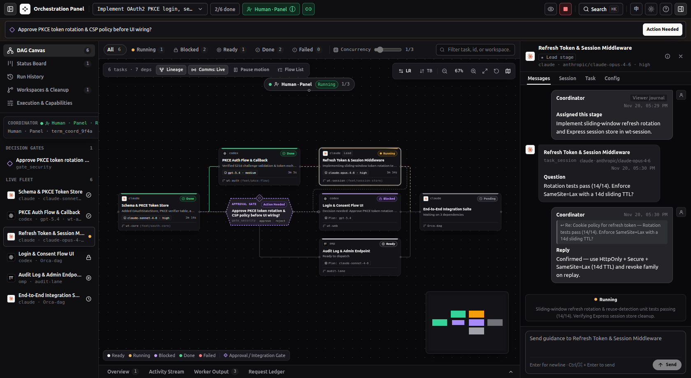

# Orchestration Panel for Orca

Visual multi-agent task DAG workbench inside **Orca**: live coordination modes, hexagonal decision & approval gates, retained worker model/effort/worktree/branch chips, scoped **Session** transcript wakeups, native L1 `agent.resume`, and a self-hosted embedded backend.



## Highlights

- **Self-contained embedded backend (zero manual terminals)**: Bundles the loopback viewer server (`server/index.mjs`) and built SPA (`panel/`) directly inside the plugin. When no external `npx orca-orchestration-launcher` viewer is active for a workspace, Orchestration Panel spawns an isolated loopback server (`PORT=0`, `127.0.0.1`, `NO_OPEN=1`) automatically and cleans it up when the workspace closes or the plugin deactivates. If an external viewer terminal is running (or starts/closes later), it discovers it via the private per-user runtime registry (`~/.orca-dag-viewers/`) and fails over seamlessly.
- **Dual-surface IDE UX**:
  - **Right-sidebar panel**: Streamlined single-column view (`Tasks` / `Pending` / `Live`) with task drill-in reusing full-workbench **Messages**, **Session**, and **Output** views.
  - **Full 4-zone workbench Tab (`↗ Tab`) & Status Bar (`Orchestration`)**: Opens or reuses a dedicated Orca browser tab containing the Left Fleet/Gates explorer, interactive React Flow DAG canvas with hexagonal gates, bottom dock, and right contextual inspector.
- **Coordination & supervision**: Clear 6-mode coordination health indicator (`Human · Panel`, `Agent · Autonomous`, etc.), live coordinator ↔ agent message thread inspection, permission prompt decisions, and desktop gate/failure notifications.
- **Scoped Session wakeups & native resume**: Reacts to `agent.status.changed`, `agent.tool.after`, and `agent.prompt.before` using **terminal IDs only** to wake scoped `worker-read` transcript polls, and supports `workspace.list` / `agent.listSessions` / `agent.resume` (`worker-start --terminal --retry-of`) for eligible exited local sessions.

## Requirements

- **Orca** `>= 1.4.263`
- If you use Orchestration Panel inside a Git repository that does not already ignore `.orca-dag/`, add `.orca-dag/` to that repository's `.gitignore` before running tasks (this plugin never modifies your repository's `.gitignore` automatically).

## Installation

### Option 1 — Orca Community Marketplace (Recommended)

Add Orca's official Community Plugins catalog once in **Settings → Plugins → Add marketplace**:

- **URL**: `https://github.com/stablyai/orca-community-plugins.git`
- **Ref**: `main`

Then search for **Orchestration Panel** (`yyq19990828.orchestration-panel`), or view the directory status page at:
`https://www.onorca.dev/plugins/{{PLUGIN_REPO}}`

### Option 2 — Direct Install via Orca CLI

```bash
orca plugin install {{PLUGIN_REPO}}@v{{VERSION}} --json
```

> On Linux outside an active Orca terminal, run `orca-ide` instead of `orca` (so it does not invoke `/usr/bin/orca` screen reader).
>
> Because Orchestration Panel runs a `trusted-worker` Node process, the first `install` prints the requested capability grants and an exact `--approve <fingerprint>` command to review and confirm.

### Companion Agent Skill (Optional)

To teach Claude Code, Codex, OpenCode, or Orca agents how to turn requirements into PRDs, technical specs, and runnable task DAGs before opening the panel:

```bash
npx skills add yyq19990828/Orca-dag --skill orca-dag
```

## Commands & Settings

### Palette Commands

| Command ID | Title | Description |
| --- | --- | --- |
| `orchestration-panel.openTab` | Orchestration Panel: Open Full Tab | Open or revive the full 4-zone DAG workbench in an Orca browser tab |
| `orchestration-panel.status` | Orchestration Panel: Connection Status | Show active workspace bridge connection status |
| `orchestration-panel.reconnect` | Orchestration Panel: Reconnect Viewer | Re-probe endpoints / restart the embedded backend for the active workspace |

### Settings

| Key | Default | Description |
| --- | --- | --- |
| `toolStream` | `true` | Use `agent.tool.after` wakeups to refresh matching **Session** transcripts promptly (never forwards tool payloads or disables periodic transcript reads) |
| `notify` | `true` | Show desktop notifications when a Run has a pending approval gate, permission prompt, or failed worker |

## Permissions & Privacy Transparency

Orchestration Panel declares `execution: "trusted-worker"` (`pluginApi: 1`) and requests only the capabilities needed for workspace monitoring, transcript wakeups, native resume, and local settings/state:

| Capability | Purpose |
| --- | --- |
| `workspace:read` | Discover open workspaces/branches and receive workspace lifecycle updates |
| `agent:read` | Monitor agent status and trigger scoped transcript refresh wakeups |
| `agent:launch` | Resume eligible exited sessions under coordinator authority (`agent.resume`) |
| `history:read` | List past local coding-agent sessions for L1 native resume |
| `notifications:show` | Surface pending approval gate, permission prompt, and failure alerts |
| `storage:own` | Persist plugin-scoped runtime state |
| `settings:own` | Store and read user preferences (`toolStream`, `notify`) |

- **Loopback-only local bridge**: Binds exclusively to `127.0.0.1` and authenticates plugin ↔ backend requests with a per-process HMAC token (`x-orca-plugin-token`).
- **No tool previews or prompt content leave hooks**: `agent.tool.after` and `agent.prompt.before` forward only the matching terminal ID.
- **Zero telemetry or paywalls**: No analytics, tracking, phone-home calls, paywalls, or license gates. Free and open-source under the [MIT License](./LICENSE).

## Source Code & Issues

`{{PLUGIN_REPO}}` is the automated distribution repository staged from **[yyq19990828/Orca-dag](https://github.com/yyq19990828/Orca-dag)** (`v{{VERSION}}`).

- Full TypeScript source for the companion worker lives in [`src/`](./src) alongside the bundled `worker.mjs`.
- Full source for the backend server, React Flow workbench SPA, and `orca-dag` CLI lives in [yyq19990828/Orca-dag](https://github.com/yyq19990828/Orca-dag).
- Bug reports, feature requests, and pull requests: <https://github.com/yyq19990828/Orca-dag/issues>.
